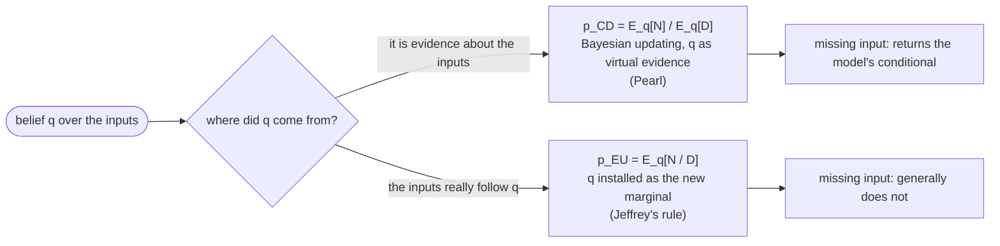
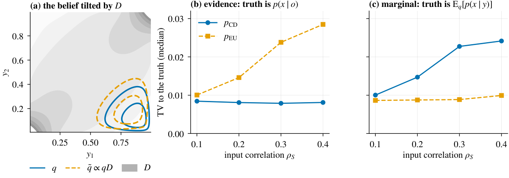
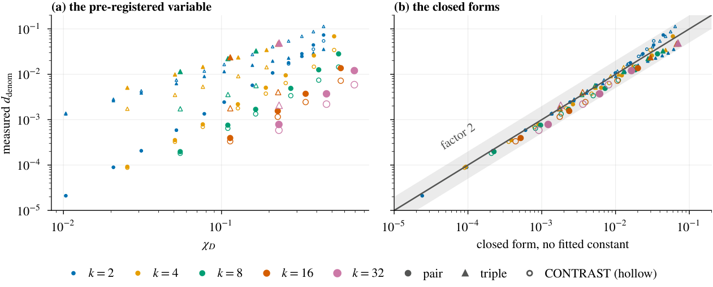
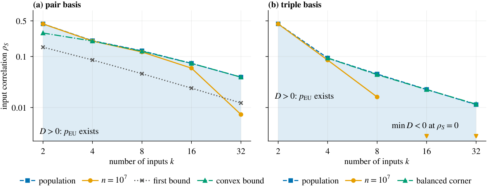

# Evidence or Marginal?

**What Moment-Vector Propagation Computes in Polynomial Density Neurons** · Przemysław Spyra, AGH University of Krakow

[](paper/main.pdf)
[](PREREGISTRATION.md)
[](pyproject.toml)
[](LICENSE)
[](LICENSE-CC-BY-4.0)

> When a neuron's input is lost, or known only through a belief *q*, what should it output?

A neuron that stores a joint polynomial density *N* with input density *D*, as in Hierarchical Correlation Reconstruction (HCR), can take a density over its inputs and return one over its output. Two formulas compete: the cheap one, one matrix-vector product, and the one it was introduced to approximate:

$$p_\mathrm{CD}=\frac{\mathrm{E}_q[N]}{\mathrm{E}_q[D]}\qquad\text{vs.}\qquad p_\mathrm{EU}=\mathrm{E}_q\left[\frac{N}{D}\right]$$

**They are not an approximation and its target. In a density model both are exact answers to different questions.**





*Two questions, two exact answers (illustration, k = 2, full tensor model). (a) Under p<sub>CD</sub> the belief q is tilted by the neuron's input density D. (b) If q is evidence about an observation, p<sub>CD</sub> matches the truth up to truncation. (c) If the inputs really follow q, p<sub>EU</sub> matches.*

## Findings at a glance

| | |
|---|---|
| **Meaning** | p<sub>CD</sub> is Pearl's virtual evidence; p<sub>EU</sub> is Jeffrey's rule. Proved, and illustrated up to k = 8 inputs outside the pair family (post hoc reading, one exploratory real-data pilot). |
| **Size** | Closed forms fall within a factor 2 of all 112 measured gaps, with no fitted constant (post hoc). |
| **Existence** | Negative density, where p<sub>EU</sub> stops existing, begins near input correlation 1/k (post hoc). |
| **Pre-registered study** | Up to 32 inputs: 5 of 15 hypotheses supported, 2 inconclusive, 8 not supported, including all three on transfer beyond equicorrelated Gaussians. |
| **Truncation** | Where p<sub>EU</sub> is defined, truncation usually outweighs the gap for Beta beliefs in pair neurons; triple neurons under flat and data beliefs are exceptions (post hoc). |

<table>
<tr>
<td width="50%"><br><sub><b>Size.</b> (a) The measured gap against &chi;<sub>D</sub>: a single power law fits only one cell. (b) Against the closed forms, with no fitted constant; the band is a factor 2. Post hoc.</sub></td>
<td width="50%"><br><sub><b>Existence.</b> Shaded: D &gt; 0, so p<sub>EU</sub> exists. (a) Pair basis with its convex lower bound. (b) Triple basis with the exact balanced-corner formula.</sub></td>
</tr>
</table>

The manuscript is [`paper/main.pdf`](paper/main.pdf). The study protocol is [`PREREGISTRATION.md`](PREREGISTRATION.md). It uses the file names of its time: `config2.yaml` is now `config.yaml`. To try it on one GPU in under 30 minutes, run `uv sync --extra torch && uv run densprop small`.

## Layout

```
src/densprop/   the study's code, as one package (below)
paper/          manuscript, figures, generated numbers and tables, post hoc analyses and the scripts that build them
results/        job lists, merged results and summaries of the study
scheduler/      cost model and Slurm scripts
tests/          unit tests; test_results.json is the record of the GPU validation run
config.yaml     study settings
three_input_study/   the earlier three-input study, self-contained
```

The package is organised in layers, from the inside out:

- `densprop.domain`: the computation, pure functions of arrays, tensors and data frames: the density neuron, copulas, propagation, chains and training, job specifications and their random streams, thresholds and hypothesis tests, the benchmark layers.
- `densprop.ports`: the interfaces through which the use cases reach the outside world (result store, job queue, record store, energy meter).
- `densprop.app`: the use cases: the worker, the merge, the analysis, the report, the validation tests, the energy benchmark.
- `densprop.adapters`: the ports on parquet, JSONL, CSV and JSON files, subprocesses and NVML, and the study figures.
- `densprop.cli`: the command line, the only place that reads the environment (`HCR_RESULTS`, `SLURM_JOB_ID`, `CUDA_VISIBLE_DEVICES`) and wires the rest together.

`results/run_record.json` holds GPU accounting, and maps the commit ids stored in the run metadata to this repository's history. For each of those ids it also lists the git tree ids of the code that ran (`gpu`, `network`, `analysis2`, `scheduler`, `tests2`, `config2.yaml`, `PREREGISTRATION.md`, under the names of the time), so the map can be checked: `git rev-parse 8abbf12:gpu` gives the tree listed for `6a98646`. The production runs used that earlier layout; the present layout is a restructuring of the same code that reproduces every stored result.

## Requirements

Python 3.10 or later. The dependencies are declared in `pyproject.toml` and locked in `uv.lock`; `requirements-lock.txt` records the environment of the production runs. With [uv](https://docs.astral.sh/uv/):

```bash
uv sync                 # the package, its dependencies and the development tools (pytest, ruff)
uv sync --extra torch   # with PyTorch, needed for the study, the validation tests and four of the paper scripts
```

PyTorch is needed for the study (writing the job lists excepted), the validation tests, and `semantics.py`, `regression.py`, `check_theory.py` and `check_identity.py` in `paper/`; rebuilding the paper from the stored results does not need it. Without uv, `pip install -e .` (or `pip install -e ".[torch]"`) in a virtual environment does the same.

## Rebuild the paper

Everything in the paper comes from the stored results. No GPU is needed.

```bash
uv sync
cd paper
uv run python make_figures.py
uv run python make_numbers.py
latexmk -pdf main.tex
uv run python check_numbers.py
```

`check_numbers.py` regenerates all numbers and tables and checks them against their sources. The per-run parquet files (`results/merged/<experiment>.parquet`, 517 MB) are not in the repository, so the checks that need them are skipped. With the six files placed in `results/merged/` (`gauss`, `population`, `convergence`, `families`, `lkj`, `network`), every check runs.

The full rebuild, from the repository root, regenerates the post hoc results and the study figures as well:

```bash
uv sync --extra torch
uv run python paper/posthoc.py        # needs the parquet files
uv run python paper/semantics.py      # PyTorch
uv run python paper/regression.py     # PyTorch
uv run python paper/check_theory.py   # needs the parquet files; PyTorch
uv run densprop figures --paper --out paper/figures   # G1-G9; G8, G9 need the parquet files
cd paper
uv run python make_figures.py
uv run python make_numbers.py
latexmk -pdf main.tex
uv run python check_numbers.py
uv run python check_identity.py    # PyTorch
uv run python make_arxiv.py
```

The outputs of the first four steps (`paper/*.json`) are in the repository, so the later steps run without them.

## Tests

```bash
uv run pytest             # unit and contract tests, seconds
uv run pytest -m slow     # also the fast validation tests on the CPU and, with the parquet files, a recomputed summary
uv run ruff check . && uv run ruff format --check .
```

## Run the study

A reduced grid, under 30 minutes on one GPU:

```bash
uv run densprop small     # --device cpu also works, more slowly
```

The full study, on a Slurm cluster with PyTorch installed:

```bash
densprop make-jobs gauss population convergence families lkj network
sbatch -A <account> --array=0-39 scheduler/slurm_array.sh results/jobs_gauss.jsonl
densprop merge gauss population convergence families lkj network
densprop thresholds gauss population families
densprop validate post --out tests/test_results.json
densprop hypotheses
densprop figures
densprop report
```

`densprop --help` lists every command; `python -m densprop` is the same. `sbatch` is repeated for each experiment's job list. A job counts as done once its result file exists, so an array can be resubmitted until the merge reports nothing missing. The Slurm scripts are site-specific: they load the cluster's Python and CUDA modules, expect a virtual environment with the dependencies in `venv/` and put `src/` on `PYTHONPATH`, so the package need not be installed there.

The time and energy benchmark runs with `sbatch -A <account> scheduler/slurm_energy.sh <float32|float64> <replicate>`, once per setting and replicate; `densprop energy --summarise` then writes `results/energy/summary.csv` and `report.txt`.

The three-input study runs on one CPU core in a few minutes with `python three_input_study/run_all.py`.

## License

The code is licensed under Apache-2.0 ([`LICENSE`](LICENSE)). The manuscript, figures and data are licensed under CC BY 4.0 ([`LICENSE-CC-BY-4.0`](LICENSE-CC-BY-4.0)). See [`NOTICE`](NOTICE); to cite, use [`CITATION.cff`](CITATION.cff).
